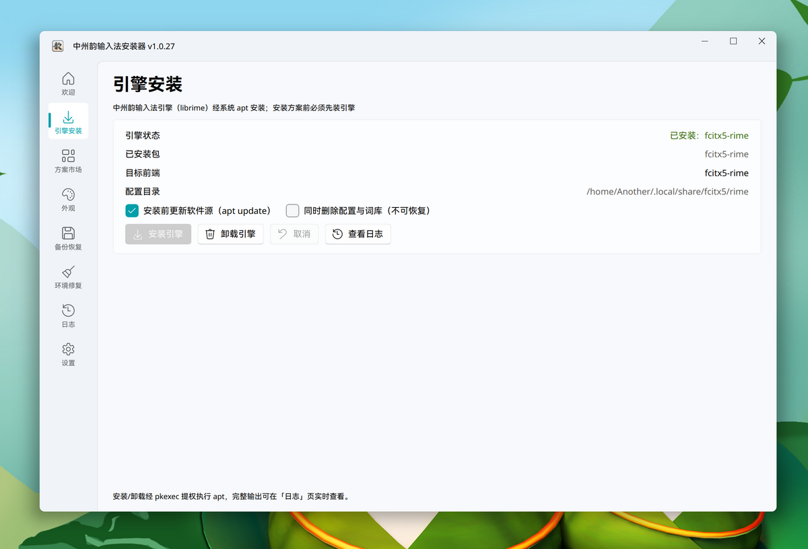
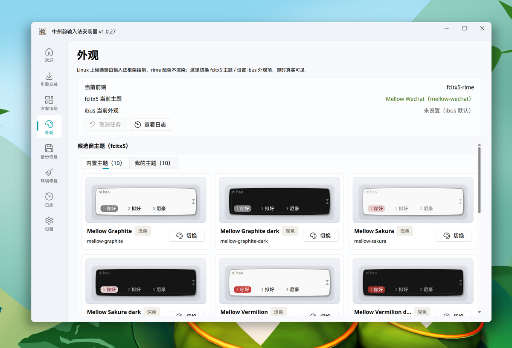
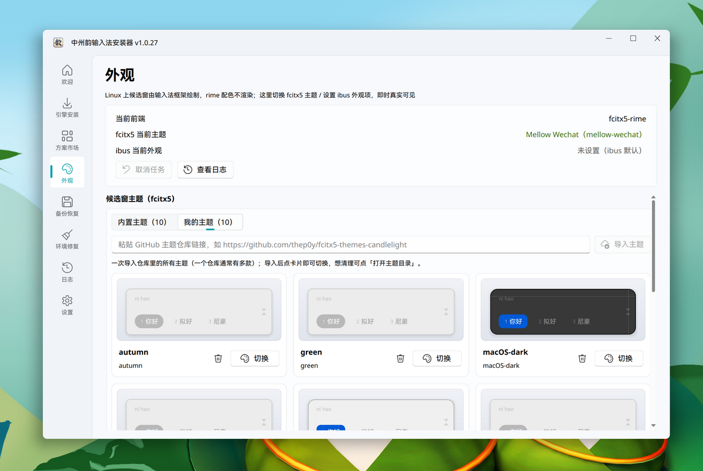
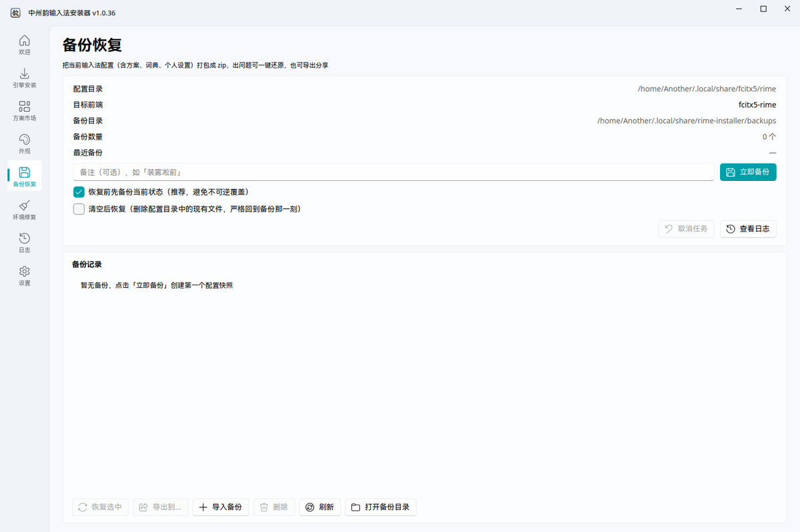
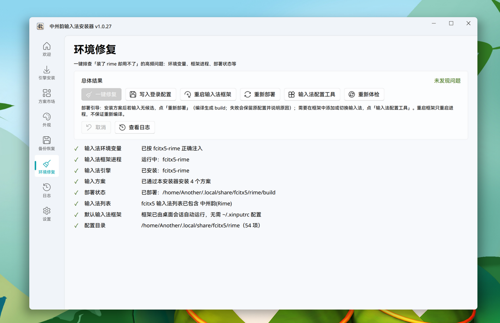
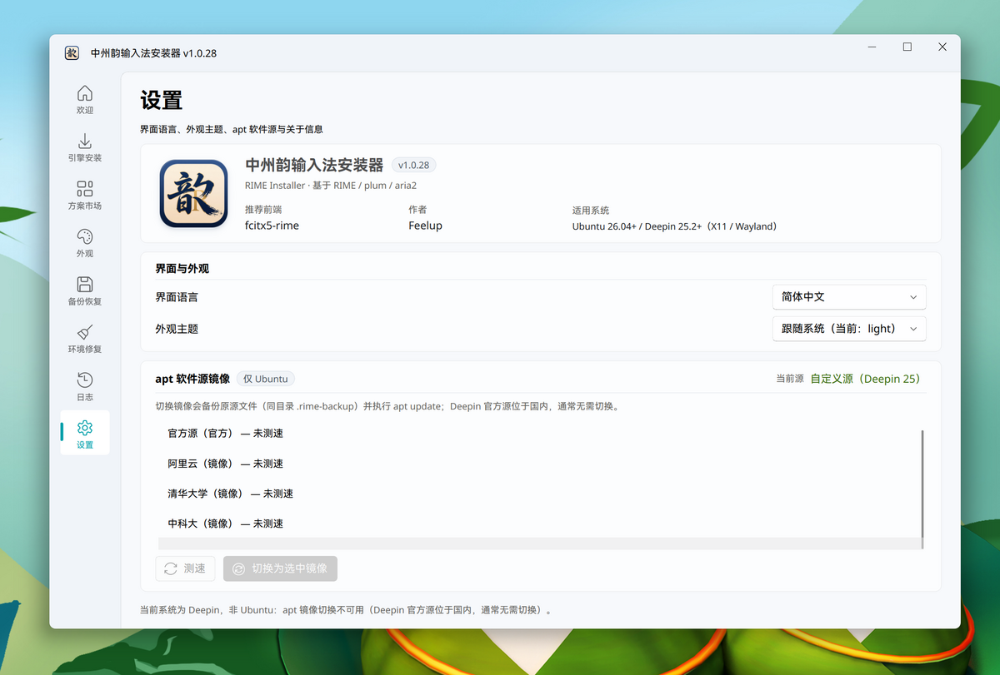

# 中州韵输入法安装器（RIME Installer）

一款面向 **Ubuntu / Linux Mint / Deepin** 的 RIME（中州韵）图形化安装与管理工具。把「装引擎、装方案、配环境、换皮肤、备份恢复、干净卸载」这条原本全靠命令行的链路，收进一个 PyQt6 + Fluent 风格的单窗口程序里。




## 它解决什么问题

中州韵是 Linux 上最强的中文输入方案平台，但装机体验劝退不少人：

| 常见困扰 | 通常要怎么做 | 本工具怎么做 |
| --- | --- | --- |
| 不知道装哪个引擎 | 手动判断桌面环境，`apt install ibus-rime` 或 `fcitx5-rime` | 自动检测框架并推荐，装引擎走 `pkexec` 提权，输出实时可见 |
| 装方案要 `git clone` + `plum` | 装 plum、用 `rime-install` 敲仓库名 | 方案市场点卡片即可，下载走内置 aria2 多线程 + 国内镜像加速 |
| 装完切不到中文 | 手改 `~/.xprofile`、手动注册输入源 | 环境体检一键查出问题项并修复（写环境变量、注册输入源、触发部署） |
| 候选窗太丑 | 翻 GitHub 找主题、解压、改 `classicui.conf`、重启框架 | 内置十余款主题，或粘贴主题仓库链接一次导入，点击即切换 |
| 改坏了想回退 | 自己备份 `~/.local/share/fcitx5/rime` | 安装前自动快照，一键恢复/导出；两阶段恢复，强杀也不会变空目录 |
| 想重装但卸不干净 | 手动找残留文件 | 基于安装清单（manifest）精确清理、还原被覆盖文件 |

## 功能一览

| 页面 | 能力 |
| --- | --- |
| **欢迎** | 首次引导，展示检测到的框架与环境概况 |
| **引擎安装** | 安装 / 卸载 `ibus-rime`、`fcitx5-rime`；可选先 `apt update`、可连配置与词库一起清理 |
| **方案市场** | 官方 preset / extra + 雾凇拼音、白霜等热门方案；支持自定义 `user/repo`；体积/来源/适用人群一目了然；装完可检查更新 |
| **外观** | fcitx5 候选窗主题切换（内置 + 一键导入仓库）、ibus 全局外观设置、真实候选窗预览、主题删除与目录直达 |
| **备份恢复** | 打包 rime 用户目录为 zip；恢复可选「先备份当前状态」或「清空后恢复」；支持导入导出、删除 |
| **环境修复** | 八项体检：环境变量、框架进程、引擎包、方案清单、部署状态、输入源注册、默认框架、配置目录；可修项一键修复 |
| **日志** | 所有外部命令（apt / aria2 / plum）的原始输出，实时可查 |
| **设置** | 界面语言（中/英）、外观深浅色、apt 软件源测速与切换、关于信息 |

### 方案市场

每张卡片给出简介、优势、适用人群、体积与来源，安装状态一目了然；顶部还能贴任意 GitHub 仓库地址装自定义方案。


下载链路是「内置 aria2 多线程拉 tarball → 预置到 plum 的包目录 → 本地 `rime-install`」，因此比原生 `git clone` 稳定得多，国内也有 gh-proxy / ghfast 镜像兜底。

### 外观与主题

内置 Mellow 系列等十余款主题，卡片里用主题自带的 svg 直接渲染真实候选窗效果（含圆角、配色、字号）。



也能粘一个 fcitx5 主题仓库链接，把仓库里所有主题一次性导入到「我的主题」，导入后同样可以预览、切换、删除。



> 说明：Linux 下 rime 自身的 `style` / `color_scheme` 不被 fcitx5-rime 读取，候选窗外观实际由 fcitx5 classicui 主题绘制，所以这里切换的是 fcitx5 主题层；ibus 用户则只调整少量全局外观项。切换后会重启输入法框架使其生效。

### 备份与恢复

备份 = 把当前 rime 用户目录（含方案、词典、个人设置）打包成 zip；恢复采用「解压到临时目录 → 搬入目标目录 → 最后清理多余文件」的顺序，避免中途强杀留下空目录。出问题还能导出备份包分享给别人复现。



### 环境修复

「装了 rime 却用不了」的高频原因逐项排查，无问题显示绿字、有问题指出原因；能修的（写环境变量、注册输入源、重新部署）一键修复，只读项只给结论不瞎改。



其中「写入登录配置」会把输入法环境变量写进 `~/.config/environment.d/`（Wayland/systemd）与 `~/.xsessionrc`（X11 登录会话）——这两个位置才真正被桌面会话读取，写 `~/.xprofile` 在 Ubuntu / Deepin 上并不生效。

「apt 源代号」项会比对 apt 源里的发行代号与当前系统：系统升级后旧代号残留（曾用本程序切换过镜像、手工添加的第三方源、升级中断）会让 apt 装到旧版包——此时体检给出警示与处理指引。该项按运行时探测比对，不为任何具体版本写死逻辑。

「apt 源可用性」项在后台逐个探测源的连通性，失效的第三方源（404 / 连接失败，如失效的 PPA、CI 仓库）会被逐一点名并给出手动禁用指引；**官方源不可达时只提示检查网络，任何情况下都不会建议你禁用系统官方源**。

### 干净卸载

引擎走 `apt` 卸载；方案与主题引入的文件按安装清单逐条删除，被覆盖的原有配置从快照还原，不留残余。

### 设置

界面语言、深浅色跟随系统、apt 镜像测速切换（备份原源后执行 `apt update`）。Deepin 官方源在国内，通常无需切换。



## 环境要求

| 项目 | 要求 |
| --- | --- |
| 系统 | Ubuntu 24.04 及以上 / Linux Mint 22 及以上 / Deepin 25.2 及以上（按运行时探测判定，系统升级后自动跟随） |
| 显示服务 | X11 或 Wayland（纯 Wayland 下自动切 xcb 兼容层） |
| 输入法框架 | `ibus-rime` / `fcitx5-rime`（自动检测推荐，可手动切换） |
| 运行时 | Python 3.11+、PyQt6（deb 的 `Depends` 已声明） |

更低版本或其它发行版未经充分验证，欢迎反馈兼容性。

## 安装

从 [Releases](../../releases/latest) 下载最新的 `.deb`，双击用软件中心安装，或：

```bash
sudo apt install ./rime-installer_1.0.28_amd64.deb
```

校验下载完整性：

```bash
sha256sum -c SHA256SUMS
```

卸载程序本体：

```bash
sudo apt remove rime-installer
```

> 想让方案文件、被覆盖的配置也一并清掉，请先运行界面里的「干净卸载」流程，再执行 `apt remove`。

## 五分钟上手

1. **引擎安装** — 打开后会推荐适合你桌面的框架，点「安装引擎」，输入密码即可；
2. **方案市场** — 挑一个方案（新手推荐「官方 preset」或「雾凇拼音」），点「安装」；
3. **环境修复** — 点「一键修复」处理环境变量与输入源注册，再点「重新部署」；
4. **外观** — 选一套候选窗主题，点「切换」（会自动重启框架）；
5. **添加输入法** — 用「输入法配置工具」把「中州韵」加到输入法列表，`Ctrl+Space` 切换即可打字。

## 从源码运行

```bash
sudo apt install python3-pyqt6 python3-pyqt6.qtsvg
python3 -m venv .venv && source .venv/bin/activate
pip install -r requirements.txt
python3 main.py
```

调试时设置 `RIME_INSTALLER_NO_RESTART=1`，可让脚本化的部署步骤不去重启真实的 fcitx5（避免打断你当前正在用的输入法）。

## 构建与测试

```bash
bash packaging/build-deb.sh          # 产物：build/rime-installer_<version>_amd64.deb
QT_QPA_PLATFORM=offscreen python3 smoke_test.py
```

版本号的唯一事实源是 `config.py` 的 `VERSION`；改动后需同步 `smoke_test.py` 末尾断言与 `REQUIREMENTS.md`。

冒烟测试覆盖：图标八档位与 RGBA 校验、i18n 键一致性、页面与状态机完整性、备份恢复、主题导入解析、deb 依赖链条等。

## 项目结构

```
main.py                  入口（平台回退、单实例、启动成功标记）
config.py                版本号与路径常量（唯一事实源）
core/                    平台探测、manifest、下载器、方案/主题/皮肤、备份、doctor
ui/                      Fluent 风格页面（方案市场、环境修复、外观、备份…）
tools/                   CLI：快照、皮肤应用、外观应用
resources/               内置行李：aria2-next 二进制、vendored plum、qfluentwidgets、内置主题
packaging/               build-deb.sh、桌面文件、多档位图标
docs/screenshots/        界面截图（README 用）
design/mockups/          设计稿与历史截图
smoke_test.py            离屏冒烟测试
REQUIREMENTS.md          需求、架构决策与逐版本变更记录
```

## 技术栈

- **UI**：PyQt6 + [PyQt-Fluent-Widgets](https://github.com/zhiyiYo/PyQt-Fluent-Widgets)（vendored）
- **下载内核**：[aria2-next](https://github.com/rayburst/rayburst)（Rust 版 aria2 CLI，随包内置 x86_64 / aarch64 双架构）
- **方案安装**：vendored [plum（东风破）](https://github.com/rime/plum)，配合本地 manifest 记录文件级变更
- **数据**：SQLite（安装清单、日志、快照索引）

## 已知限制

- Linux 下 rime 配色方案的生效范围有限，主题切换主要改变候选窗外观与字体排版，而非 rime 自身的 `color_scheme`；
- 引擎安装与软件源切换需要提权，会弹出密码框；
- 已适配 Ubuntu 24.04 及以上 / Linux Mint 22 及以上 / Deepin 25.2 及以上；版本判定为「家族 + 最低版本」通配（见 `core/compat.py`），不枚举具体版本——系统升级到更高版本（含未来新 LTS）后无需升级本程序即可继续使用，实际判定结果见「设置 → 当前系统」。更老版本的 Qt6 与 fcitx5 行为差异较大，未经充分验证。
- Linux Mint 的 apt 源由 mint 自带工具管理，本程序的「设置 → apt 镜像」在 Mint 上只做展示，需要换源请用 mint 的「软件源」；
- 若系统里挂着已失效的第三方 apt 源（返回 404 或缺公钥），`apt update` 会失败——程序已自动忽略该错误继续安装，但建议在「软件源」里禁用它。

## 致谢

- [RIME / 中州韵](https://rime.im/) 与 [plum](https://github.com/rime/plum)
- [fcitx5](https://github.com/fcitx/fcitx5) 与 Mellow 主题作者
- [PyQt-Fluent-Widgets](https://github.com/zhiyiYo/PyQt-Fluent-Widgets)
- [aria2-next](https://github.com/rayburst/rayburst)
- 雾凇拼音 [iDvel/rime-ice](https://github.com/iDvel/rime-ice)、白霜 [gaboolic/rime-frost](https://github.com/gaboolic/rime-frost) 等方案作者

## 许可

[GPL-3.0](LICENSE)
